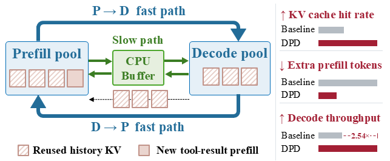
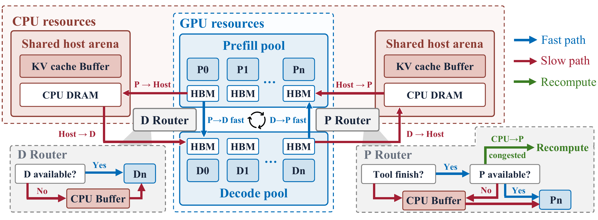
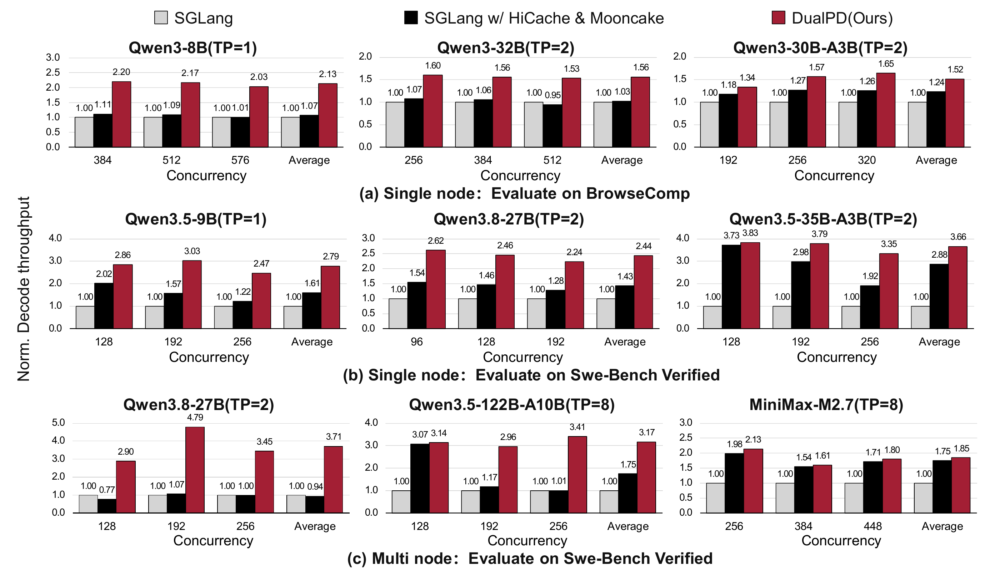

<h1 align="center">DPD</h1>

<p align="center">
  <strong>Bidirectional Dual-Path KV Transfer for Efficient Prefill–Decode Disaggregated Agentic LLM Serving</strong>
</p>

<p align="center">
  <a href="LICENSE"></a>
  <a href="https://github.com/jamescsq47/sglang"></a>
  <a href="#installation"></a>
</p>

<p align="center">
  <a href="#overview">Overview</a> ·
  <a href="#method">Method</a> ·
  <a href="#results">Results</a> ·
  <a href="#installation">Installation</a> ·
  <a href="#usage">Usage</a> ·
  <a href="#documentation">Documentation</a>
</p>

**DPD keeps KV states with the task across agentic turns.** It co-schedules
each task with its complete logical KV states, moving them between prefill (P),
decode (D), and temporary CPU staging as execution progresses. This improves
cross-turn reuse without requiring a historical copy to remain cached on a
particular P worker.

Across the paper's BrowseComp and SWE-Bench Verified experiments, DPD achieves
**2.54× average decode throughput over SGLang** and **1.87× over SGLang with
HiCache and Mooncake**.

<p align="center">
  
</p>

## Overview

Agentic tasks alternate between model generation and tool execution. Each tool
result introduces new input that must be prefilled before decoding resumes.
As the conversation grows, losing historical KV states causes repeated prefill
of the same context. Long tool waits and high concurrency make this problem
particularly costly.

DPD aligns KV placement with task progress: P workers construct or extend
the states, D workers use and extend them during generation, and CPU memory
temporarily holds states that are waiting for tools or GPU capacity. KV
ownership moves after a successful handoff, so the source can release the
task's references rather than retaining another competing copy.

<p align="center">
  
</p>

## Method

DPD combines the following mechanisms into a cross-turn state pipeline:

| Component | What it does |
| --- | --- |
| **Task-coupled KV management** | Schedules each task with its complete logical KV states. Physical radix-cache prefix sharing remains supported; releasing one task does not delete blocks still referenced by others. |
| **Bidirectional KV transfer** | Adds D-to-P return to the usual P-to-D flow. The next prefill can reuse the updated history, and routing can select a feasible worker instead of requiring the previous one. |
| **Tool-aware D-to-P scheduling** | Uses direct GPU transfer when the tool output and P-side admission are ready within their waiting budgets. Otherwise, it stages states in CPU DRAM to free D-side HBM. Eligible tool-ready requests fall back to recomputation when direct admission fails and the Host-to-P restore queue is congested. |
| **Reservation-free P-to-D admission** | Selects a D worker after prefill completes. States transfer directly when D has capacity or wait in CPU memory, avoiding advance reservations for requests that cannot yet decode. |
| **Bounded host-memory management** | Keeps P-to-D staged states non-evictable. The D-to-P buffer uses capacity limits and recomputation-cost-aware eviction under pressure. Transfer queues advance independently of GPU forward execution. |

The two directions work together: D-to-P return reduces repeated prefill,
while late P-to-D admission keeps advance reservations from obstructing the
state pipeline and occupying memory needed by active decode batches.

### One task, multiple turns

1. **Initial prefill:** a P worker processes the prompt and constructs KV states.
2. **P-to-D handoff:** the D router selects a worker after prefill completes;
   direct transfer is preferred, with CPU staging when D cannot yet admit it.
3. **Decode and tool execution:** D generates tokens until completion or a tool
   call. The return scheduler chooses direct D-to-P transfer, host staging,
   or an eligible recomputation fallback.
4. **Next-turn prefill:** an admitted P worker reuses the returned states and
   processes the newly appended tool output. The cycle then repeats.

During transfer, the source remains responsible until the destination has
installed and acknowledged the complete states. Temporary physical copies
may coexist in flight; the source releases its references after completion.

## Results

The paper evaluates selected models from the **Qwen3, Qwen3.5, Qwen3.8, and
MiniMax** families on **BrowseComp** and **SWE-Bench Verified**, using single-node
and two-node H100 deployments. The following figure retains all nine model
and deployment panels from the paper.

<p align="center">
  
</p>

| Evaluation group | Average speedup over SGLang | Average speedup over SGLang + HiCache + Mooncake |
| --- | :---: | :---: |
| Single-node BrowseComp | **1.74×** | **1.58×** |
| Single-node SWE-Bench Verified | **2.96×** | **1.61×** |
| Two-node SWE-Bench Verified | **2.91×** | **2.42×** |
| **Overall** | **2.54×** | **1.87×** |

Speedups are arithmetic means of per-configuration decode-throughput ratios.
Single-node experiments use one 8-GPU H100 server; two-node experiments use
two 8-GPU servers. Each setting uses its profiled P:D allocation, with the
same configuration for the compared methods. Concurrency denotes admitted
agentic tasks, rather than the number of requests actively decoding.

**Measurement protocol.** Both benchmarks execute agents and tools rather than
replaying trajectories. BrowseComp uses a fixed local retrieval corpus, with
300 seconds of warmup followed by 1,200 seconds of steady-state measurement.
SWE-Bench Verified throughput counts all output tokens generated until 90% of
tasks finish, divided by elapsed wall-clock time, to exclude the final long-tail
phase. KV-cache hit rate is the fraction of tokens submitted for prefill whose
KV states can be reused.

These results summarize the paper's evaluated configurations. The launch
examples below use the pinned [SGLang fork](https://github.com/jamescsq47/sglang/tree/main)
and provide a concrete Qwen3-8B setup; model paths, topology, memory capacities,
and tool environments must match the experiment being run.

## Installation

### Environment

Use Linux, NVIDIA GPUs with peer-to-peer access, Conda, and an NVIDIA driver
and CUDA toolkit compatible with the pinned engine's PyTorch dependencies.
The example below uses **8 × H100 80 GB** and **768 GiB of Host KV arenas**;
reserve additional CPU RAM for model loading, retrieval, Python and the OS
(roughly 1.5–2 TiB node RAM is recommended for this example).
Install `git`, `curl`, `unzip`, `numactl`, `iproute2` (`ss`), a C/C++ compiler
and CUDA development tools using your site's package manager.

```bash
git clone --recurse-submodules https://github.com/jamescsq47/DualPD.git
cd DualPD
# For an existing clone without submodules:
git submodule update --init --recursive

conda create -n dualpd python=3.12 -y
conda activate dualpd
python -m pip install --upgrade pip setuptools wheel setuptools-scm

# Install the pinned fork, not stock SGLang from PyPI.
python -m pip install --no-build-isolation -e ./3rdparty/sglang/python
python -m pip install -e '.[analysis]'
python -m pip install -r configs/environment/runtime.txt

export DUALPD_ENGINE_ROOT="$PWD/3rdparty/sglang"
export SGLANG_OVERLAY_ROOT="$DUALPD_ENGINE_ROOT/python"
export PD_ENV_BIN="$(dirname "$(command -v python)")"
source runtime/env.sh

python -m pip check
python -m dualpd doctor
python runtime/launch/environment.py --expect modified
```

Run the remaining commands from the repository root. Set the engine variables
and source `runtime/env.sh` again in each new shell. The engine's dependency
metadata selects PyTorch, Transformers, FlashInfer and kernel versions; do not
replace them with unrelated latest versions. Native kernels may compile on
first use. Registered batched-DMA support depends on available CUDA APIs;
unsupported operations retain the engine's fallback path. This recipe is not
a lockfile for every CUDA/platform combination.

Keep the submodule at its recorded commit for reproducibility. Baselines need
a separate baseline environment and engine, not this modified one.

### Models and datasets

Replace `/path/to/...` with your storage locations. Prefer local scratch
storage for models, caches and results.

```bash
export PD_MODEL_ROOT=/path/to/models
export PD_DATA_ROOT=/path/to/datasets
export HF_HOME="$PD_DATA_ROOT/huggingface-cache"
mkdir -p "$PD_MODEL_ROOT" "$PD_DATA_ROOT"
# If a resource requires authentication: hf auth login

hf download Qwen/Qwen3-8B --local-dir "$PD_MODEL_ROOT/Qwen3-8B"
```

The generation model is [Qwen/Qwen3-8B](https://huggingface.co/Qwen/Qwen3-8B).
Other checkpoints can be selected through `MODEL_PATH`, but their tensor
parallelism, memory limits and parsers must also match the model; changing
only the path does not make every topology compatible with every model.

**BrowseComp.** The retained workload uses the 680-question `bc_train.parquet`
split released by [FoldAgent](https://github.com/sunnweiwei/FoldAgent), not the
test-only Tevatron question split. Download its
[data archive](https://drive.google.com/file/d/1aX5xXAN5R-gLKd8A0AY-troxXJRawyAM/view)
and convert it:

```bash
mkdir -p "$PD_DATA_ROOT/browsecomp/raw"
python -m gdown 1aX5xXAN5R-gLKd8A0AY-troxXJRawyAM \
  -O "$PD_DATA_ROOT/browsecomp/raw/browsecomp_data.zip"
unzip "$PD_DATA_ROOT/browsecomp/raw/browsecomp_data.zip" \
  -d "$PD_DATA_ROOT/browsecomp/raw"
find "$PD_DATA_ROOT/browsecomp/raw" -name bc_train.parquet

# Adjust --input if the archive contains an extra directory level.
python -m dualpd.data.browsecomp.prepare \
  --input "$PD_DATA_ROOT/browsecomp/raw/bc_train.parquet" \
  --output "$PD_DATA_ROOT/browsecomp/bc_train.jsonl"
```

Search uses a local corpus, not the live web. Prefetch the
[embedding model](https://huggingface.co/Qwen/Qwen3-Embedding-8B),
[corpus](https://huggingface.co/datasets/Tevatron/browsecomp-plus-corpus) and
[precomputed embeddings](https://huggingface.co/datasets/miaolu3/browsecomp-plus)
into the same cache used at runtime:

```bash
hf download Qwen/Qwen3-Embedding-8B
hf download --repo-type dataset Tevatron/browsecomp-plus-corpus
hf download --repo-type dataset miaolu3/browsecomp-plus corpus_embeddings.pkl
export SEARCH_SERVER_EMBEDDING_CACHE="$(python -c \
  'from huggingface_hub import hf_hub_download; print(hf_hub_download("miaolu3/browsecomp-plus", "corpus_embeddings.pkl", repo_type="dataset"))')"
```

The search service loads the corpus through Hugging Face Datasets; the first
run may additionally prepare its dataset cache. Embeddings are pickle-based:
use only a trusted source.

**SWE-bench Verified (optional).** This requires a working Docker daemon
accessible to your user, CPU/RAM for task containers and substantial image/
workspace storage. Export the official
[500-task test split](https://huggingface.co/datasets/princeton-nlp/SWE-bench_Verified):

```bash
python -m pip install -e '.[swe]'
python -m pip install -r configs/environment/swe.txt
python -m dualpd.data.swe_bench_verified.prepare \
  --dataset princeton-nlp/SWE-bench_Verified --split test \
  --output "$PD_DATA_ROOT/swe-bench-verified/test.jsonl"
docker info
```

Tasks use official per-instance images from
[Docker Hub](https://hub.docker.com/u/swebench). Prefetch before timing; the
following downloads all 500 and can require substantial space and time:

```bash
python - "$PD_DATA_ROOT/swe-bench-verified/test.jsonl" <<'PY' | while IFS= read -r image; do
import json
import sys
for line in open(sys.argv[1]):
    row = json.loads(line)
    instance = row['instance_id'].lower().replace('__', '_1776_')
    print(row.get('image_name') or f'swebench/sweb.eval.x86_64.{instance}:latest')
PY
  docker pull "$image" || exit 1
done
```

## Usage

Model-specific Qwen3.5, Qwen3.8 and MiniMax experiment launchers are listed in
[the main-method model/topology table](scripts/new-method/README.md#model-specific-swe-experiments-allocated-slurm-nodes),
with corresponding [native baseline commands](scripts/baseline/README.md#model-specific-entries).
These preserve model-specific launch recipes; the examples below introduce
the smaller Qwen3-8B configuration.

Use an exclusively allocated GPU node with idle GPUs and free ports, not a
login node. Activate the environment and set the variables above first.
Run one case at a time with a new `RUN_DIR`.

`scripts/` contains only `ablation/`, `baseline/` and `new-method/` experiment
entries. Shared process startup/cleanup is implemented in `runtime/launch/`;
data preparation belongs to the corresponding workload under `data/`.

### BrowseComp: single-node 4P:4D, TP=1

This starts four Prefill workers, four Decode workers, the router, local search
and the workload client. It uses c512, **300 seconds of business warmup +
1200 seconds of measurement**, temperature 0 and total D→P/P→D Host capacities
of **512/256 GiB**.

```bash
MODEL_PATH=/path/to/models/Qwen3-8B \
PD_DATA_ROOT=/path/to/datasets \
RUN_DIR=/path/to/results/browsecomp-qwen3-8b-c512 \
  bash scripts/new-method/run_qwen3_8b.sh browsecomp
```

Startup, model loading and Host registration precede business warmup and are
not included in the measurement window. Closed-loop mode keeps agents in
flight and cycles through the question pool as needed. Concurrency is set in
the launch script: edit `BROWSECOMP_CONCURRENCY=512` in
`scripts/new-method/run_qwen3_8b.sh` to change it (SWE uses
`SWE_CONCURRENCY=64`). No concurrency export is required.
Topology, sampling, transfer and Host settings are already defaults in
`scripts/new-method/run_qwen3_8b.sh`; set an environment variable only when
overriding one. Host sizes are per Prefill rank (128/64 GiB × four ranks).
GPU 7 shares retrieval and uses a lower Decode memory fraction. These examples
do not export workload-specific settings into your shell.

### BrowseComp baselines: No-reverse and HiCache + Mooncake

Use a **separate clean baseline environment** with the
[`pd_baseline` engine branch](https://github.com/jamescsq47/sglang/tree/pd_baseline).
Do not install the modified `3rdparty/sglang` engine into this environment.
If you do not already have a baseline environment, prepare one in a fresh shell:

```bash
git clone --single-branch --branch pd_baseline \
  https://github.com/jamescsq47/sglang.git /path/to/sglang-baseline
conda create -n dualpd-baseline python=3.12 -y
conda activate dualpd-baseline
python -m pip install --upgrade pip setuptools wheel setuptools-scm
python -m pip install --no-build-isolation -e /path/to/sglang-baseline/python
python -m pip install -e '.[analysis]' \
  'mooncake-transfer-engine==0.3.12.post1' 'sglang-router==0.3.2'
```

From the DPD repository root, run **one command at a time**:

```bash
# No-reverse PD: no D→P KV reuse.
BASELINE_ENV_BIN=/path/to/envs/dualpd-baseline/bin \
MODEL_PATH=/path/to/models/Qwen3-8B \
PD_DATA_ROOT=/path/to/datasets \
RUN_DIR=/path/to/results/browsecomp-no-reverse-c512 \
  bash scripts/baseline/run_qwen3_8b_browsecomp.sh no_reverse

# Native HiCache + Mooncake, including Decode KV offload.
BASELINE_ENV_BIN=/path/to/envs/dualpd-baseline/bin \
MODEL_PATH=/path/to/models/Qwen3-8B \
PD_DATA_ROOT=/path/to/datasets \
RUN_DIR=/path/to/results/browsecomp-hicache-c512 \
  bash scripts/baseline/run_qwen3_8b_browsecomp.sh hicache
```

Both use TP=1, 4P:4D, c512 and the same 680-question source order,
temperature and 300+1200-second measurement protocol. Their concurrency is
set by `BROWSECOMP_CONCURRENCY=512` in the baseline launch script. The HiCache
case defaults to 128 GiB per P worker, 56 GiB per D worker and a 256 GB Mooncake
store; these are native baseline capacities, not the new method's arenas.
The baseline launcher clears the modified engine overlay and agentic switches,
and the existing environment gate rejects engines with custom modules.
Mooncake master/client executables must be available in `BASELINE_ENV_BIN`.

### SWE-bench: 500 tasks with Docker

This independent command keeps Qwen3-8B/4P:4D, disables retrieval and evaluates a finite
500-task workload, not a timed closed-loop workload:

```bash
MODEL_PATH=/path/to/models/Qwen3-8B \
PD_DATA_ROOT=/path/to/datasets \
RUN_DIR=/path/to/results/swebench-qwen3-8b-c64 \
  bash scripts/new-method/run_qwen3_8b.sh swe
```

This YAML selects the OpenEnv-style local harness with structured OpenAI
`shell` tool calls, isolated Docker environments and inline hidden-test
verification—not the separate mini-SWE-agent harness. It allows 64 turns and
8192 output tokens per turn, truncating observations to 12000 characters.
Container execution and verification need resources independently of the
model; begin with modest concurrency. This is a usage example, not a claim of
reproducing another model's published accuracy.

The workload configuration, parsers, 500-task limit and c64 concurrency are
selected automatically. Both commands preserve explicit environment overrides;
if reusing an old shell with manually exported experiment settings, unset those
settings first or use a fresh shell.

### Outputs and checks

`RUN_DIR` contains `config.json`, `resolved_workload.json`, `requests.jsonl`,
`summary.json`, `engine_metrics.jsonl` and service logs under `logs/`.
Closed-loop runs also record `closed_loop_boundaries.json` and
`closed_loop_events.jsonl`. Use those boundaries—not launcher wall time—for
steady-state metrics.

```bash
python -m dualpd inference --help
python -m dualpd slurm --help
python -m dualpd multinode --help
```

The launcher manages startup and process-group cleanup. After a failed run,
confirm its GPU processes and ports are gone before restarting; do not bypass
resource gates. Slurm, network and container settings must match your site.
This release includes launch code and public workload adapters, not raw
datasets, internal run outputs or development test fixtures. File organization
checks are not new GPU throughput or accuracy measurements.

## Documentation

| Resource | Contents |
| --- | --- |
| [New-method launchers](scripts/new-method/README.md) | DPD launch scripts and experiment entry points. |
| [Baseline launchers](scripts/baseline/README.md) | Separate SGLang and HiCache + Mooncake environments. |
| [Ablations](scripts/ablation/README.md) | Transfer, routing and Host-capacity ablation commands. |
| [Service deployment](runtime/launch/README.md) | Shared local and multi-node launch implementation. |
| [Workload data](data/README.md) | Public data sources, license information and harnesses. |
| [Application runtime](runtime/README.md) | Client-side workload execution and KV lifecycle notifications, distinct from the GPU engine. |

## Acknowledgments

DPD builds on [SGLang](https://github.com/sgl-project/sglang). Its direct
transfer path uses SGLang's NIXL/UCX integration. The installation instructions
pin the modified engine and the baseline engine separately for reproducibility.

## License

This repository is distributed under the [Apache License 2.0](LICENSE).
Third-party components retain their respective licenses.

For questions, bug reports, or reproducibility issues, please open a
[GitHub issue](https://github.com/jamescsq47/DualPD/issues).
