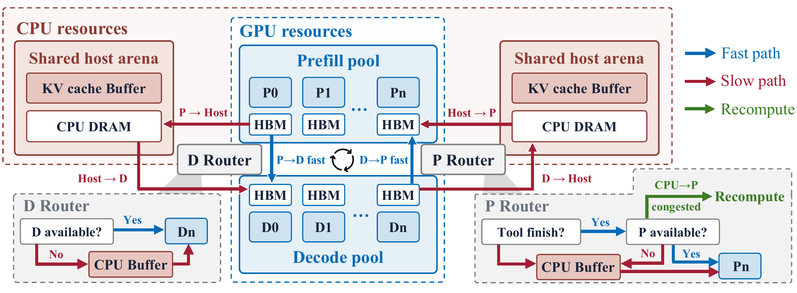
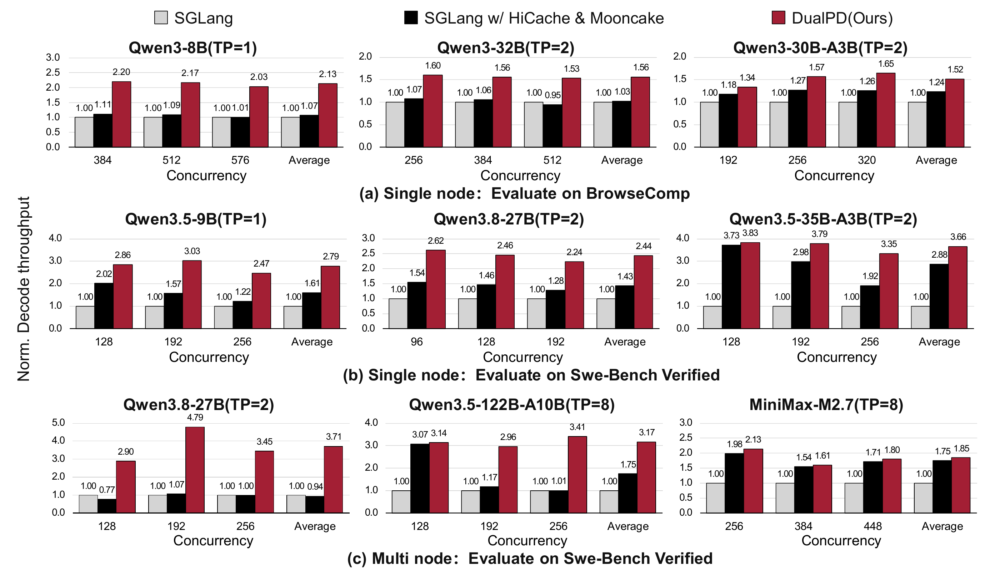

<h5 align="center">DPD: Bidirectional Dual-Path KV Transfer for Efficient Prefill–Decode Disaggregated Agentic LLM Serving</h5>

## Overview

DPD couples each agentic task with its KV states and transfers them in both
directions between prefill (P) and decode (D) workers. After a tool call, D-to-P
return lets the next prefill reuse the updated history rather than recompute
it. Each direction supports direct GPU transfer and CPU staging: tool-aware
D-to-P scheduling stages states when tool execution or P admission takes too
long, while late P-to-D admission selects a D worker after prefill completes.
Transfers progress independently of model computation, reducing repeated
prefill and freeing GPU memory without requiring affinity to a previous worker.

<p align="center">
  
</p>

## Results

<p align="center">
  
</p>

Across the evaluated BrowseComp and SWE-bench Verified configurations, DPD
achieves **2.54× average decode throughput over SGLang** and **1.87× over
SGLang with HiCache and Mooncake** (arithmetic means of per-configuration ratios).

## Installation

Requires Linux, Python ≥3.12, Conda, NVIDIA GPUs and a compatible CUDA development
toolkit, C/C++ compiler, `git`, `curl`, `unzip`, `numactl` and `iproute2`.
The example uses 8 × H100 80 GB and 768 GiB of Host KV arenas;
1.5–2 TiB of node RAM is recommended.

```bash
git clone --recurse-submodules https://github.com/jamescsq47/DualPD.git
cd DualPD
conda create -n dualpd python=3.12 -y
conda activate dualpd
python -m pip install --upgrade pip setuptools wheel setuptools-scm
python -m pip install --no-build-isolation -e ./3rdparty/sglang/python
python -m pip install -e '.[analysis]'
python -m pip install -r configs/environment/runtime.txt

export DUALPD_ENGINE_ROOT="$PWD/3rdparty/sglang"
export SGLANG_OVERLAY_ROOT="$DUALPD_ENGINE_ROOT/python"
export PD_ENV_BIN="$(dirname "$(command -v python)")"
source runtime/env.sh

python -m pip check
python -m dualpd doctor
python runtime/launch/environment.py --expect modified
```

Run from the repository root. In a new shell, activate the environment and
repeat the engine exports and `source runtime/env.sh`. Keep the pinned engine
and its dependencies; native kernels may compile on first use.

### Model and data

```bash
export PD_MODEL_ROOT=/path/to/models
export PD_DATA_ROOT=/path/to/datasets
export HF_HOME="$PD_DATA_ROOT/huggingface-cache"
mkdir -p "$PD_MODEL_ROOT" "$PD_DATA_ROOT"
hf download Qwen/Qwen3-8B --local-dir "$PD_MODEL_ROOT/Qwen3-8B"
```

**BrowseComp:** download the 680-question training split from
[FoldAgent's archive](https://drive.google.com/file/d/1aX5xXAN5R-gLKd8A0AY-troxXJRawyAM/view)
and prepare the local search corpus:

```bash
mkdir -p "$PD_DATA_ROOT/browsecomp/raw"
python -m gdown 1aX5xXAN5R-gLKd8A0AY-troxXJRawyAM \
  -O "$PD_DATA_ROOT/browsecomp/raw/browsecomp_data.zip"
unzip "$PD_DATA_ROOT/browsecomp/raw/browsecomp_data.zip" \
  -d "$PD_DATA_ROOT/browsecomp/raw"
# Adjust --input to the extracted bc_train.parquet location.
python -m dualpd.data.browsecomp.prepare \
  --input "$PD_DATA_ROOT/browsecomp/raw/bc_train.parquet" \
  --output "$PD_DATA_ROOT/browsecomp/bc_train.jsonl"

hf download Qwen/Qwen3-Embedding-8B
hf download --repo-type dataset Tevatron/browsecomp-plus-corpus
hf download --repo-type dataset miaolu3/browsecomp-plus corpus_embeddings.pkl
export SEARCH_SERVER_EMBEDDING_CACHE="$(python -c \
  'from huggingface_hub import hf_hub_download; print(hf_hub_download("miaolu3/browsecomp-plus", "corpus_embeddings.pkl", repo_type="dataset"))')"
```

Use only trusted pickle embeddings. Keep `HF_HOME` and the embedding-cache
setting available when launching BrowseComp.

**SWE-bench Verified (optional):** requires Docker, task-image storage and the
[official 500-task split](https://huggingface.co/datasets/princeton-nlp/SWE-bench_Verified).

```bash
python -m pip install -e '.[swe]'
python -m pip install -r configs/environment/swe.txt
python -m dualpd.data.swe_bench_verified.prepare \
  --dataset princeton-nlp/SWE-bench_Verified --split test \
  --output "$PD_DATA_ROOT/swe-bench-verified/test.jsonl"
docker info
```

Prefetch the official [task images](https://hub.docker.com/u/swebench) before running:

```bash
python - "$PD_DATA_ROOT/swe-bench-verified/test.jsonl" <<'PY' | while IFS= read -r image; do
import json
import sys
for line in open(sys.argv[1]):
    row = json.loads(line)
    instance = row['instance_id'].lower().replace('__', '_1776_')
    print(row.get('image_name') or f'swebench/sweb.eval.x86_64.{instance}:latest')
PY
  docker pull "$image" || exit 1
done
```

Data sources and license information: [data/README.md](data/README.md).

## Usage

Use an exclusively allocated GPU node, one experiment at a time, with a fresh
`RUN_DIR`. The examples use Qwen3-8B, TP=1 and 4P:4D.

### BrowseComp

Defaults: c512, 300-second warmup + 1200-second measurement, D→P/P→D Host
capacities of 512/256 GiB. Change `BROWSECOMP_CONCURRENCY` in the launcher to
select another concurrency.

```bash
MODEL_PATH=/path/to/models/Qwen3-8B \
PD_DATA_ROOT=/path/to/datasets \
RUN_DIR=/path/to/results/browsecomp-qwen3-8b-c512 \
  bash scripts/new-method/run_qwen3_8b.sh browsecomp
```

### Baselines

Prepare a separate environment using the clean
[`pd_baseline` branch](https://github.com/jamescsq47/sglang/tree/pd_baseline):

```bash
git clone --single-branch --branch pd_baseline \
  https://github.com/jamescsq47/sglang.git /path/to/sglang-baseline
conda create -n dualpd-baseline python=3.12 -y
conda activate dualpd-baseline
python -m pip install --upgrade pip setuptools wheel setuptools-scm
python -m pip install --no-build-isolation -e /path/to/sglang-baseline/python
python -m pip install -e '.[analysis]' \
  'mooncake-transfer-engine==0.3.12.post1' 'sglang-router==0.3.2'
```

Run each command separately; Mooncake executables must be in `BASELINE_ENV_BIN`.
Both use the same BrowseComp concurrency and measurement window as above.

```bash
BASELINE_ENV_BIN=/path/to/envs/dualpd-baseline/bin \
MODEL_PATH=/path/to/models/Qwen3-8B \
PD_DATA_ROOT=/path/to/datasets \
RUN_DIR=/path/to/results/browsecomp-no-reverse-c512 \
  bash scripts/baseline/run_qwen3_8b_browsecomp.sh no_reverse

BASELINE_ENV_BIN=/path/to/envs/dualpd-baseline/bin \
MODEL_PATH=/path/to/models/Qwen3-8B \
PD_DATA_ROOT=/path/to/datasets \
RUN_DIR=/path/to/results/browsecomp-hicache-c512 \
  bash scripts/baseline/run_qwen3_8b_browsecomp.sh hicache
```

### SWE-bench Verified

Activate the modified-engine environment. Defaults: 500 tasks, c64, structured
`shell` tool calls and isolated Docker environments.

```bash
MODEL_PATH=/path/to/models/Qwen3-8B \
PD_DATA_ROOT=/path/to/datasets \
RUN_DIR=/path/to/results/swebench-qwen3-8b-c64 \
  bash scripts/new-method/run_qwen3_8b.sh swe
```

For other models/topologies, see [new-method launchers](scripts/new-method/README.md)
and [baseline launchers](scripts/baseline/README.md). Additional experiments:
[ablations](scripts/ablation/README.md).

Results and logs are written to `RUN_DIR`. After a failed run, confirm its GPU
processes and ports are cleared before restarting.

## Acknowledgments

We thank MIT-IBM Watson AI Lab, Amazon and MIT Science Hub, MIT AI Hardware Program, National Science Foundation, and Samsung for supporting this research. We thank NVIDIA for donating the DGX server.

DPD builds on [SGLang](https://github.com/sgl-project/sglang).

## License

[Apache License 2.0](LICENSE). Third-party components retain their respective licenses.
